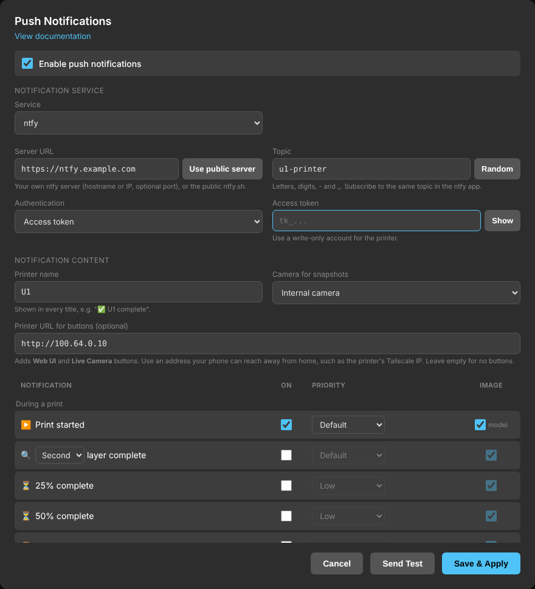

# Push Notifications

Print, progress and error notifications with camera snapshots, sent to your
phone through [ntfy](https://ntfy.sh) (the public `ntfy.sh` server or your own),
[Gotify](https://gotify.net) (text only), [Pushover](https://pushover.net), [Telegram](https://telegram.org),
[Discord](https://discord.com), and/or by email (Gmail, Brevo or any SMTP
server), and/or to a webhook for home automation.



**Contents:** [What it provides](#what-it-provides) ·
[Choosing a service](#choosing-a-service) ([Gotify](#gotify),
[Telegram](#telegram), [Webhook](#webhook), [Discord](#discord),
[Email](#email)) · [Requirements](#requirements) · [Setup](#setup) ·
[Self-hosting a push server](#self-hosting-a-push-server) · [Notifications from macros](#notifications-from-macros-and-g-code)
([ntfy](#ntfy-server), [Gotify](#gotify-server)) · [Security](#security) ·
[Configuration file](#configuration-file) · [Troubleshooting](#troubleshooting)

## What It Provides

| Notification | Image | Notes |
|---|---|---|
| ▶️ Print started | Model preview | The slicer thumbnail, and the slicer's estimated print time and ETA. With Moonraker's job queue in use: "Print 1/N remaining in queue", counting this one, and their total time |
| ⏸️ Print paused / ▶️ Print resumed | Camera | Resumed includes time left and ETA |
| 🎬 First layer started | Camera | Off by default. When the first layer begins, after the start routine (homing, bed mesh, flow calibration can take a while): time to watch it go down. With time left and ETA |
| 🔍 1st / 2nd / 3rd layer complete | Camera | Choose after which layer (default: 2nd). With time left and ETA. When printing by object (Orca's *print sequence: by object*), once per object, counted from the object's own first layer, or once per print job |
| ⏳ 25% / 50% / 75% complete | Camera | Same percentage as Fluidd and the Snapmaker app, with time left and ETA |
| ✅ Print complete | Camera | Includes print time, and the prints still in the job queue with their total time. When printing by object: once per object as each one finishes and the next begins ("📦 object complete", with which object, e.g. "Object 2 of 3: Assembly", and time left; the last object's is the Print complete notification itself), or once per print job |
| 🚫 Print cancelled | Camera | |
| 📐 Manual calibrations | Camera | Calibrations started from the touchscreen (bed levelling, XYZ offset, flow, input shaper): "📐 … Bed levelling complete" when one finishes (or hands over to the next queued one), "📐 … failed" when the printer drops into its abnormal state instead, and "🖐️ … user intervention needed" when one reaches a step that waits for you (brush the nozzle of Toolhead N; the screen waiting for a tap: nothing running in Klipper for more than 15 s). Not for the bed mesh inside a print job's start routine |
| 📣 From macros and G-code | Camera | Sent by any macro or G-code line: `RESPOND PREFIX=notify MSG="<title> \|\| <message> \|\| <priority>"` (see [Notifications from macros](#notifications-from-macros-and-g-code)) |
| 🧵 Filament loaded / unloaded | Spool | Off by default. When filament is loaded into or unloaded from a toolhead (the printer's own detection), with the toolhead and the filament, drawn as a spool in its colour (a multi-colour filament as wedges, one per colour); with Spoolman, the spool's name and how much is left. Loaded and unloaded can be ticked separately. Not during a print job: runouts and refills have their own notifications |
| 🌡️ Waiting for chamber temperature | Camera | When a print job, before its first layer, waits for a target chamber temperature: from any chamber heater (DragonBreath, Panda Breath, any `heater_generic`, set by `M141`/`M191`) or Snapmaker's own chamber wait (`WAIT_CHAMBER_TEMP`, which only waits with Snapmaker's purifier connected). Nothing is sent when there is no target, e.g. bed-only heating with no purifier: nothing waits then |
| 🌡️ Reached chamber temperature | Camera | When the chamber reaches the target, or is within 5 °C of it when the first layer starts (`M191` releases a few degrees short) |
| ⚠️ Chamber faults | Camera | **Timed out**: the first layer started (or Snapmaker's wait gave up) with the chamber more than 5 °C below target; the print job carries on below target. **Not heating**: no rise of 1 °C in 10 minutes while waiting. **DragonBreath**: a heater fault (with DragonBreath's own fault text) or the heater not responding, during the print job. Each says what happens next (printer still waiting, or print job continuing). A heater that stops heating altogether eventually trips Klipper's heater check: that's the 🛑 Klipper shutdown notification |
| ⚠️ Error | Camera | Faults that pause or stop a print, e.g. filament runout or a dirty bed |
| ⚠️ Warning | Camera | Faults that don't stop a print, e.g. a toolhead contact warning |
| 🛑 Klipper shutdown | Camera | Heater, thermistor and MCU faults, emergency stop |
| ⚡ Power loss recovery | Camera | Sent after boot when an interrupted print can be resumed, with a photo of the part (the camera gets up to 45 seconds to start) |
| 🌡️ Driver running hot | Camera | When the X or Y stepper driver reaches the set temperature (default 105 °C; the TMC2240 reports its own temperature, and warns itself at 120 °C). Once per print job, and again after a pause, so a print job paused for the heat and resumed can warn a second time, while a driver hovering at the limit doesn't send one after another. Shows both drivers' temperatures |
| ▶️ Resumed after power loss | Camera | Sent instead of *Print started* when a recovered print continues (uses the *Resumed* settings), with time left and ETA |
| 🧵 Not enough filament | Spools | Spoolman: when a toolhead the print uses has less filament than the rest of the print needs (red), or only just enough, within 20 g or 5% (orange: "may be insufficient"). Checked at print start, as one notification for all toolheads at risk, and again during the print when a toolhead gets worse. If refill is on, says which spools the printer can refill from, in the order it would use them (exact colour match first, in toolhead order; with "ignore colour", then the nearest colour; each one refilling the next as it runs out), shown as a chain of arrows in the picture, how much each has, and which same-material toolheads the printer will *not* refill from and why (no filament info set, another nozzle, a different vendor or sub-type, or the colour with exact match required), whether it's an exact match or only a compatible spool, and whether together they're enough, or that no refill spool was found. A loaded spool that Spoolman shows at 0 g or less is reported once, at print start, as "amount of filament left is unknown" (it isn't used for any other check); turn that warning off in the Spoolman section of the form if you don't track spool weights. Nothing is sent when all spools are fine |
| 🧵 Spool running low | Spool | Spoolman: when a spool is down to a set % of a full spool (default 10%) or a set weight (default 50 g), whichever comes first. Sent once per spool, until it is refilled or replaced; time to buy a new one. Spools that run low at the same time (e.g. at print job start) come in one notification. With refill on, it shows the spool the printer would refill from (or that there is none) |
| 🔄 Switched to backup spool | Spools | When the printer refills a filament from another toolhead mid-print (its own refill, with or without Spoolman). The runout that caused it isn't reported as an error when this row is on: the printer refills by itself within seconds. With Spoolman: the spools' names and remaining weights |

Each notification can be sent by push, by email, or both, with its own
priority (push) and image setting. For example: progress by push only, and
errors by push and email. By default, faults and power loss are also emailed.

- **Time left and ETA**: Calculated like Fluidd's default estimate (print
  time so far, divided by file progress). This also holds after a
  power-loss recovery, which keeps the print time and progress of the
  interrupted print. ETAs are shown in the time zone of the browser you last
  saved the settings from, since the printer's clock runs on UTC.
- **Error codes**: Error, warning and shutdown notifications include the
  Snapmaker error code in the same format the printer uses
  (`level-module-index-code`, e.g. `0002-0532-0000-0001: detected dirty bed`)
  with the same title and advice the printer's screen shows for that code
  (e.g. `Possible Spaghetti Defect Detected`). Some kinds of fault get an
  emoji before the code: 🌡️ temperature, 💾 storage space, ☁️ cloud, 📐
  calibration, 🍝 spaghetti, 🧵 spool and filament, 🔧 toolhead. Also an
  **Error Index** link to the
  [U1 error code reference](https://wiki.snapmaker.com/en/snapmaker_u1/troubleshooting/u1_error_codes).
- **Named pictures**: every picture is sent as a file named with the time,
  printer, notification and print job, e.g.
  `2026-10-22_17-05-03_U1-martha_50pct_Benchy.jpg`, so saved or exported
  images keep their context. Letters, digits, `.`, `_` and `-` only.
- **Snapshots before parking**: For *Print complete* and *Cancelled*, the
  nozzle lifts straight up 15 mm off the part and the snapshot is taken then,
  while the
  printer's own end/cancel moves carry on, so the image shows the part and the
  nozzle doesn't stop over it and ooze onto it. There is no lift if Z is
  not homed, and the lift is reduced near the top of the build volume so the
  stock end/cancel moves stay in range. For *Paused*, the snapshot is taken
  3 seconds after the pause starts, once the nozzle has moved off the part.
- **Images never block a notification**: Images are uploaded as files, so your
  phone doesn't need to reach the printer. If the camera is unavailable, the
  notification is sent without the image.
- **Spoolman**: The Spoolman notifications appear when the
  [Spoolman integration](spoolman.md) is enabled. They use each toolhead's
  assigned spool and the slicer's per-filament weights, mapped to toolheads
  the way the print was started (including touchscreen remapping). With
  refill on, backup spools count as "any compatible spool" (same material)
  or "same exact spool" (same vendor, material, type and colour), like the
  printer's own setting. Spools are checked once a minute while printing.
  What a toolhead still needs is measured, not guessed: the slicer's
  weight for its filament minus what Spoolman says its spools (including
  a refill spool it moved to) used since the print job started. This
  needs Spoolman to be tracking usage (SpoolLink does); if nothing was
  used 5% into the print job, the checks during the print job are skipped
  and only the check at the start runs. After a power-loss recovery, what
  was used before the power loss isn't known, so only the running-low
  alert is sent.
  Toolheads are numbered 1-4, as on the printer. The pictures show each
  spool in its Spoolman colour, filled to how much is left (in 10% steps of
  a full spool), in red (not enough), orange (may be insufficient or
  running low) or green (enough).
- **Long messages**: Pushover allows 1024 characters per message, ntfy
  about 4 KB, and Telegram and Discord about 4000 characters. A not-enough-filament notification that doesn't fit is split
  into several (e.g. "(1/2)", "(2/2)"), never in the middle of a toolhead,
  each with the pictures of its own toolheads. Only if one toolhead's text
  doesn't fit on its own are the file name and spool names shortened with
  "…". Email has no limit.
- **File names** are shown without the `.gcode` extension.
- **Retries**: When the service answers with an error, or can't be reached,
  the notification is retried after 6, 10 and 30 seconds (4 attempts), then
  given up. Push and email are sent and retried separately. If the printer
  has no network at all (e.g. Wi-Fi not connected
  yet after a power loss), each attempt first waits up to 10 minutes for it;
  that wait doesn't count as an attempt. Each attempt waits up to 60 seconds
  for the server's answer before it counts as failed, so a slow image upload
  isn't sent twice. The
  last attempt is sent without the image, in case the image is what the
  server rejects. Notifications are sent one at a time per service, so while
  one is retrying the next ones wait and arrive in order.
- **Links**: ntfy notifications get up to three buttons: **Web UI** and
  **Live Camera** (with a printer URL set) and, for faults, **Error Index**.
  Pushover allows one link: **Web UI** when a printer URL is set, otherwise
  **Error Index** on fault notifications. Emails, Telegram and Discord have
  the same links as ntfy, in the text.

## Choosing a Service

| | Setup | Privacy |
|---|---|---|
| **ntfy.sh** (public server) | None: pick a topic and subscribe to it in the [ntfy app](https://docs.ntfy.sh/subscribe/phone/) | **Public**: anyone who knows or guesses the topic can read the notifications, including images and file names |
| **ntfy** (your own server) | [Self-host ntfy](https://docs.ntfy.sh/install/) | Private, with access control |
| **Gotify** | [Self-host Gotify](https://gotify.net/docs/install), create an application in its web UI for the app token. Text only (see [Gotify](#gotify)) | Private, on your own server |
| **Pushover** | Pushover account and app (30-day free trial, then a one-time purchase per platform), plus an application token | Private to your account |
| **Telegram** | A bot of your own, made in Telegram in a minute (see [Telegram](#telegram)) | Private chat with your bot, or a group you choose |
| **Discord (direct message)** | A bot of your own in the Discord Developer Portal, added to a server you are in (see [Discord](#discord)) | Direct messages to you |
| **Discord (server channel)** | A webhook for a channel on a server you manage (see [Discord](#discord)) | Everyone who can see the channel |

To use the public server, choose **ntfy** and click **Use public server** next
to the Server URL. Firmware Config asks you to confirm the privacy warning and
keeps showing it under the server field. The public server is fine for
testing; for everyday use, setting up your own ntfy server is a good idea. On
the public server, use a long, unguessable topic: the **Random** button
creates one, and topics shorter than 16 characters are rejected.

On Gotify, **Min** to **Max** are Gotify's priorities 0, 3, 5, 8 and 10 (low,
moderate, normal, high, emergency); how the Gotify app treats each is set in
the app.

On Pushover, **High** and **Max** both use Pushover's high priority. Pushover's
emergency priority, which repeats until acknowledged, is not used.

Telegram and Discord have no priorities: **Min** and **Low** notifications
arrive without a sound, the others normally.

### Gotify

Enter the server URL (e.g. `https://gotify.example.com`, or with a path if it
sits behind a reverse proxy under one) and an app token: in the Gotify web UI,
**Apps > Create Application**. Notifications are Markdown, with the Web UI and
Live Camera links in the text when a Printer URL is set.

Gotify messages can't carry attachments, so Gotify gets **no pictures**,
whatever the Image column says; email and the webhook still get them.

### Telegram

1. In Telegram, open [@BotFather](https://t.me/BotFather) and send `/newbot`.
   Choose a display name and a username ending in `bot` (e.g.
   `martha_u1_bot`).
2. BotFather replies with a **token** (`123456789:ABC...`). Paste it into
   **Bot token**.
3. Open your new bot (BotFather links to it) and press **Start**.
4. Leave **Chat ID** empty and click **Send Test** or **Save & Apply**: the
   chat is found from your Start message. Telegram keeps it for 24 hours; if
   it's older, send the bot any message and try again.

For a group instead (e.g. to share notifications), add the bot to the group,
send a message in the group, then save with **Chat ID** empty. A chat ID can
also be entered by hand: a number, `-100...` for a group or channel, or
`@channelname` for a public channel the bot posts in.

The image comes with the text under it. Messages longer than Telegram's
1024-character caption limit arrive as the image followed by the text.

### Webhook

A webhook can be added alongside the push service and email, for Home
Assistant, Node-RED, n8n or your own scripts. Check **Send every
notification to a webhook** and paste the URL. It gets every notification,
whatever the Push and Email columns say (the receiver picks by `event`),
each as an HTTP POST with a JSON body:

```json
{
  "version": "1.0",
  "title": "✅ U1 complete",
  "message": "Benchy\nPrint time: 1h 12m",
  "type": "success",
  "event": "complete",
  "printer": "U1",
  "web_ui": "http://u1/",
  "live_camera": "http://u1/webcam/webrtc",
  "attachments": [{"filename": "snapshot.jpg", "mimetype": "image/jpeg", "base64": "..."}]
}
```

`type` is `info`, `success`, `warning` or `failure`; `event` is the
notification (`started`, `first_layer`, `progress_25`, `paused`, `complete`,
`error`, `filament_low`, ...; `test` for Send Test). The links appear when a
printer URL is set, and `error_index` on faults. The URL's own query
parameters and a `user:password@` login are kept. Priority isn't sent.

### Discord

Discord has two options. Discord's bots can only message people they share a
server with, so both need a server: any server works, including an empty
one you create just for this (**+** in the server list, **Create My Own**).

**Direct message** (notifications come to you privately, from your own bot):

1. Open the [Discord Developer Portal](https://discord.com/developers/applications)
   and click **New Application**. Name it (e.g. `U1-martha`) and create it.
2. Go to **Bot** and click **Reset Token**, then **Copy**. Paste it into
   **Bot token**. The token is shown only once; if you lose it, reset it
   again.
3. Click **Save & Apply**. If the bot isn't in a server yet, the error
   message includes a link: open it, pick your server, and click
   **Authorize**. Then save again.
4. **Send to (user ID)** can stay empty: messages go to the account that made
   the bot. To send to someone else, enter their user ID (with **Developer
   Mode** on under **Settings > Advanced**, right-click them and choose
   **Copy User ID**). They must share a server with the bot.

If the test says the bot can't message you, check that the server you added
the bot to allows direct messages from its members (the server's name >
**Privacy Settings** > **Direct Messages**).

**Server channel** (notifications are posted in a channel):

1. In Discord, open the channel's **Edit Channel** (the gear icon) >
   **Integrations** > **Webhooks** > **New Webhook**.
2. Optionally rename it (notifications show the printer name either way),
   then click **Copy Webhook URL** and paste it into **Webhook URL**.
3. Optionally, a **Mention** for high and max priority notifications, so
   they notify you even if the channel is muted: your user ID, `role:` and a
   role ID, `everyone` or `here`.

Each Discord notification is one message with a coloured bar (green when
complete, orange for pauses, cancellations and spool warnings, red for
faults and not enough filament, grey otherwise) and the image.

### Email

Email is sent through an SMTP server, so it works with any email provider.
The form has presets:

| Provider | Server | Username | Password | From |
|---|---|---|---|---|
| **Gmail** | `smtp.gmail.com:587`, STARTTLS | Your Gmail address | An [app password](https://myaccount.google.com/apppasswords) (needs 2-Step Verification), not your Google password | Your Gmail address |
| **Brevo** | `smtp-relay.brevo.com:587`, STARTTLS | Your SMTP login (`…@smtp-brevo.com`) | An SMTP key, under [SMTP & API](https://app.brevo.com/settings/keys/smtp) | A sender verified in Brevo |
| **Other** | Your provider's SMTP server; usually port 587 with STARTTLS or 465 with SSL/TLS | | | |

On **Brevo**, also check **Security > Authorised IPs**
(https://app.brevo.com/security/authorised_ips): if IP blocking is on, Brevo
rejects the printer with `525 Unauthorized IP address`. Allow your
network's public IP, or turn the blocking off (most home connections get a
new public IP from time to time, which would block email again).

Emails can go to up to 5 addresses. Each email is a card with a coloured bar for the kind of notification (green when complete, orange for pauses, cancellations and spool warnings, red for faults), the image inside it, and the links as buttons. Mail apps that don't show HTML get a plain-text version.

Emails about one print are one conversation in your email app: they share
the subject (printer and file name, e.g. `U1: Benchy`) and the notification
itself is the heading of the email. Faults join the print's conversation
while it prints and up to 2 minutes after it ends, and a power loss joins
the print it interrupted; other emails (e.g. an idle warning) have the
notification as their subject.

## Notifications from macros and G-code

Any Klipper macro or G-code line (a farm loop, an ejection macro, the
slicer's start or end G-code) can send a notification with Klipper's
`RESPOND` command and the prefix `notify`:

```
RESPOND PREFIX=notify MSG="Print ejection complete || Ejected {printer.print_stats.filename}"
RESPOND PREFIX=notify MSG="Print ejection failed || Plate still occupied, queue paused || max"
```

- Fields are separated by ` || ` (space, two pipes, space): the title (before
  the first separator), the message, and optionally a priority (`min`, `low`,
  `default`, `high` or `max`) as the last field. Without one, the row's
  **Default** priority is used. Whether a camera picture is attached is the
  row's image checkbox, not up to the macro.
- Keep file names in the message, not the title. Don't use `;` anywhere:
  Klipper ends the line there.
- In macros, Jinja template variables work (`{printer.print_stats.filename}`);
  in the slicer's custom G-code, its placeholders (`{input_filename_base}`).
- On a printer without push notifications, or with them off, the line is only
  console output: nothing fails.

## Requirements

- For images on a **self-hosted ntfy** server, attachments must be enabled
  (`base-url` and `attachment-cache-dir` in the server's `server.yml`, see
  [ntfy server](#ntfy-server)). Otherwise notifications arrive without
  images.
- For camera images, the **paxx12** camera service for the selected camera
  (the default for the internal camera, see [Camera Support](camera_support.md)).
- For *Layer complete*, the slicer must emit `SET_PRINT_STATS_INFO`
  layer information (the Snapmaker U1 Orca profile includes it).
- For print-by-object (*Layer complete* and *Print complete* for each
  object), the slicer's **Exclude objects** (label objects) setting must
  be on, so the G-code marks each object (Snapmaker Orca has it on by
  default). The print sequence is read from the file's config block.

## Setup

1. Open [Firmware Config](firmware_config.md) and go to
   **Settings > Monitoring & Debugging > Push Notifications**, then click
   **Configure**.
2. Check **Enable notifications**. Push, email and the webhook each have
   their own checkbox; at least one must be on. For push, choose the
   **Push service**:
   - **ntfy**: enter your **Server URL** (e.g. `http://192.168.1.10:8080`), or
     click **Use public server** for ntfy.sh. Keep the default **Topic** (`u1`),
     or enter or generate another, and
     subscribe to it in the ntfy app. On your own server, choose
     **Authentication**: none, an access token (`tk_...`), or username &
     password.
   - **Gotify**: enter the **Server URL** and an **App token** (see
     [Gotify](#gotify)).
   - **Pushover**: enter your **User key** and the **Application API token**,
     and optionally a device name.
   - **Telegram**: see [Telegram](#telegram).
   - **Discord**: see [Discord](#discord).
3. For email, check **Send email notifications**, choose the **Email
   provider**, and enter the username, password, From and To (see
   [Email](#email)).
4. Optionally set a **Printer URL** for the links. On first setup it is filled in
   automatically: the Tailscale name if Tailscale is running, otherwise the
   local IP. Clear it for no links, or change it with:
   - **Use Tailscale** fills in the printer's Tailscale (MagicDNS) name, e.g.
     `http://u1`, which works from anywhere your phone is on the tailnet. It is
     available when [Tailscale](vpn.md) is enabled and logged in. The name is
     used rather than the Tailscale IP because the IP changes if Tailscale is
     turned off and on again in Firmware Config (the printer rejoins as a new
     device). The name needs MagicDNS, which is on by default. Telegram
     can't link to a host without a dot, so for Telegram the Tailscale IP is
     sent in place of the name (the form says so under the field); any other
     dot-less name is refused for Telegram.
   - **Use local IP** fills in the printer's LAN address. The links then only
     work while your phone is on the same network as the printer.
5. Choose which notifications you want (**Push** and/or **Email**), with
   priority and image.
6. Click **Send Test** to check the connection. It sends a test to each
   service you set up, at **Max** priority. On failure, the log shows the service's response
   (e.g. `forbidden, error=40301` for an ntfy token without write access to
   the topic, or `535` for a wrong email password).
7. Click **Save & Apply**.

Saving restarts Moonraker and/or Klipper only when the generated
configuration changed, and only when the printer is idle. While a print is
running (or if the printer state can't be checked), settings are saved but
services are not restarted. They apply after you restart Moonraker and
Klipper (**Actions**) or reboot.

## Self-hosting a push server

A server of your own keeps notifications (camera pictures and file names
included) private. It runs anywhere Docker runs: a home server, a NAS, a
Raspberry Pi. The printer only needs to reach it, and your phone needs to
reach it from wherever you want notifications: on your home network, over
[Tailscale](vpn.md), or from the internet behind HTTPS.

### ntfy server

1. **Create a folder** for it (e.g. `ntfy/`) with this `docker-compose.yml`:

   ```yaml
   services:
     ntfy:
       image: binwiederhier/ntfy
       container_name: ntfy
       command: serve
       environment:
         - TZ=Etc/UTC
       volumes:
         - ./cache:/var/cache/ntfy
         - ./etc:/etc/ntfy
       ports:
         - 8080:80
       restart: unless-stopped
   ```

2. **Configure it** in `etc/server.yml`:

   ```yaml
   base-url: "http://192.168.1.10:8080"   # address of your ntfy server
   cache-file: "/var/cache/ntfy/cache.db"
   auth-file: "/var/cache/ntfy/user.db"
   auth-default-access: "deny-all"        # nobody reads or writes without a login
   attachment-cache-dir: "/var/cache/ntfy/attachments"
   # upstream-base-url: "https://ntfy.sh" # needed for the iPhone app (step 7)
   ```

   `base-url` and `attachment-cache-dir` are both needed for the pictures:
   without them ntfy rejects attachments and notifications arrive without
   images. Behind a reverse proxy, set `base-url` to the public HTTPS address
   and add `behind-proxy: true`.

3. **Start it**: `docker compose up -d`.

4. **Create a user and a token for the printer**:

   ```
   docker exec -it ntfy ntfy user add --role=admin you
   docker exec -it ntfy ntfy token add you
   ```

   The second command prints a token (`tk_...`). An admin can read and write
   every topic. For a printer account that can only post to its topic, use
   `ntfy user add printer`, `ntfy access printer u1 write-only` and
   `ntfy token add printer` instead (each after `docker exec -it ntfy`).

5. **In Firmware Config**: Push service **ntfy**, Server URL
   `http://192.168.1.10:8080`, Topic `u1`, Authentication **Access token**,
   and paste the token. **Send Test**.

6. **On your phone**: install the ntfy app, add your server (Settings >
   Manage users, with your login), and subscribe to the topic. On Android, turn
   on *instant delivery* for the subscription so notifications don't wait for
   the phone's background sync.

7. **iPhone: relay through ntfy.sh, or notifications won't alert.** iOS
   doesn't let the ntfy app stay connected to your server in the background,
   and only ntfy.sh can wake it (through Apple's push service). Without this,
   notifications show up when you open the app, but never alert. Your
   `etc/server.yml` for an iPhone:

   ```yaml
   base-url: "http://192.168.1.10:8080"   # address of your ntfy server
   cache-file: "/var/cache/ntfy/cache.db"
   auth-file: "/var/cache/ntfy/user.db"
   auth-default-access: "deny-all"
   attachment-cache-dir: "/var/cache/ntfy/attachments"
   upstream-base-url: "https://ntfy.sh"
   ```

   `base-url` must be exactly the server address you added in the iPhone
   app: ntfy.sh matches the two by it. Then restart the server (`docker
   compose restart`, or `docker restart <container>` if you started it with
   `docker run`). Your server then sends ntfy.sh
   only the message ID and a hash of the topic, never the message itself;
   ntfy.sh wakes the app, and the app fetches the notification from your
   server. Android doesn't need this. See ntfy's
   [iOS instant notifications](https://docs.ntfy.sh/config/#ios-instant-notifications).

**Reaching it from outside your home**: either over [Tailscale](vpn.md) (use
the server's Tailscale address in Firmware Config and in the app), or behind a
reverse proxy with HTTPS (Caddy, nginx, Cloudflare Tunnel). Behind Cloudflare,
keep its *Browser Integrity Check* in mind: it blocks requests from clients it
doesn't recognise as browsers (error 1010), which can catch scripts and
`curl` tests; the printer's own sends are not affected.

### Gotify server

```yaml
services:
  gotify:
    image: gotify/server
    container_name: gotify
    environment:
      - GOTIFY_DEFAULTUSER_PASS=change-me
    volumes:
      - ./data:/app/data
    ports:
      - 8081:80
    restart: unless-stopped
```

Start it with `docker compose up -d`, sign in to `http://<server>:8081` as
`admin` with that password (and change it), then **Apps > Create
Application** and copy the app token. In Firmware Config: Push service
**Gotify**, the Server URL and the token. Install the Gotify app on Android
and log in to the same server; Gotify has no official iPhone app. Gotify
notifications are text only (see [Gotify](#gotify)).

## Security

- On `ntfy.sh`, notifications are public to anyone with the topic name (see
  above).
- On your own ntfy server, give the printer a dedicated user with
  **write-only** access to its topic, e.g.
  `ntfy access u1-printer u1-printer write-only`.
- For email, use an app password or SMTP key, which you can revoke on its
  own, rather than your account password.
- Telegram and Discord bot tokens and the Discord webhook URL let anyone
  who has them send messages as the bot. If one leaks, reset it (BotFather
  `/revoke`, Developer Portal **Reset Token**, or delete the webhook).
- Tokens, passwords and the webhook address are kept in Moonraker's
  secrets file (`/home/lava/printer_data/moonraker.secrets`, readable by
  Moonraker only), not in `extended2.cfg` or the generated config, which
  refer to them as `{secrets.notifications.…}`. Moonraker never serves,
  logs or backs up that file. Anyone who can reach Firmware Config can
  still change where notifications go, so enable **Web Authentication**
  under **Settings > Remote Access** if your network isn't trusted.
- A saved token or password is only reused for the service and server it
  was entered for: switching the push service, the ntfy server, or the
  email server, port, security or username asks for it again, so a secret
  is never sent to another host.

## Configuration File

Settings are stored in `extended2.cfg` under `[notifications]`:

```ini
[notifications]
enabled: true
push_enabled: true
provider: ntfy
server: https://ntfy.example.com
topic: u1-printer
auth: token
username:
pushover_user:
pushover_device:
telegram_chat:
discord_user:
discord_mention:
secret:                      # kept in moonraker.secrets, see Security
printer_url: http://100.64.0.10
camera: internal
name: U1
layers_complete: 2
driver_temp: 105             # °C, X or Y stepper driver
# When printing by object: each | once
first_layer_objects: each
complete_objects: each
email_enabled: true
email_host: smtp.gmail.com
email_port: 587
email_security: starttls
email_username: you@gmail.com
email_password:              # kept in moonraker.secrets
email_from: you@gmail.com
email_to: you@gmail.com
webhook_enabled: false
webhook_url:
# <notification>: on|off (push), <priority>, image|no_image, email|no_email
started: on, default, image, no_email
paused: on, default, image, no_email
error: on, max, image, email
...
```

From this, the firmware generates (on save, and on every Moonraker and
Klipper start):

- `extended/moonraker/notifications.cfg`: the `[push_notifications]`
  Moonraker component, with one [Apprise](https://github.com/caronc/apprise)
  URL per enabled notification and service (Discord uses the firmware's own
  `discordhook://` and `discorddm://` senders).
- `extended/klipper/notifications.cfg`: the `_PRINT_END_NTFY` and
  `_CANCEL_PRINT_NTFY` [print hooks](klipper_hooks.md).

Don't edit the generated files; they are overwritten.

**Save & Apply** restarts only the service whose generated file changed.
Moonraker can restart during a print job (the print carries on; Fluidd
reconnects), so rows, priorities, images and services can be changed any
time. Klipper only reads its config at start, so a change to what the
print-end macros do (*Print complete*, *Print cancelled* and *Error*: on
or off, email, camera image; the camera, or enabling notifications, push,
email or the webhook) is refused while printing, naming the settings, and
nothing is saved. A save is also refused while printing when the
print-end macros on the printer are older than the firmware. Anything that
is saved takes effect right away. A restart that fails is reported in red
and done on the next Save & Apply.

For other services
(Slack, Matrix, etc.), add your own Moonraker
[`[notifier]`](https://moonraker.readthedocs.io/en/latest/configuration/#notifier)
section in a separate file in `extended/moonraker/` (see
[Klipper and Moonraker Custom Includes](klipper_includes.md)).

## Troubleshooting

- **Console**: Fluidd and Mainsail's console shows each notification as
  it's sent, e.g. `Sent notification "✅ U1 complete" to ntfy, email, with
  picture`, and each failed attempt with a few words on why, e.g. `!! Failed
  to send notification "✅ U1 complete" to email (timed out), attempt 2/4,
  will retry in 10 seconds`.
- **Nothing arrives**: use **Send Test** first. Then check
  `/home/lava/printer_data/logs/moonraker.log` for lines starting with
  `[push_notifications]`.
  Each notification is logged per service, e.g. `error (email): sent`, or as
  `attempt N failed` for each retry and `send failed after 4 attempts` (with
  the service's error just before each). A notification that was
  deliberately skipped is logged as `not sent, ...` with the reason, e.g. an
  error already reported by the pause it caused.
- **Self-hosted ntfy, iPhone: notifications are in the app but don't
  alert**: the server needs `upstream-base-url: "https://ntfy.sh"` (see
  [ntfy server](#ntfy-server), step 7).
- **No emails**: check the spam folder, and use **Send Test**: `535` means
  the username or password was rejected (Gmail needs an app password, Brevo
  an SMTP key). On Brevo, `525 Unauthorized IP address` means Brevo's IP
  blocking is on: allow your IP, or turn the blocking off, under
  **Security > Authorised IPs**.
- **Telegram: "Open your bot in Telegram and press Start"**: the bot has no
  message from you in the last 24 hours. Send it any message and try again.
- **Discord: "the bot can't message you"**: the bot isn't in a server you
  are in, or that server doesn't allow DMs from its members (see
  [Discord](#discord)).
- **Notifications arrive without images**: check the camera service, and on a
  self-hosted ntfy server that attachments are enabled.
- **No layer-complete notification**: the G-code file has no
  `SET_PRINT_STATS_INFO` lines; enable layer information in the slicer.
